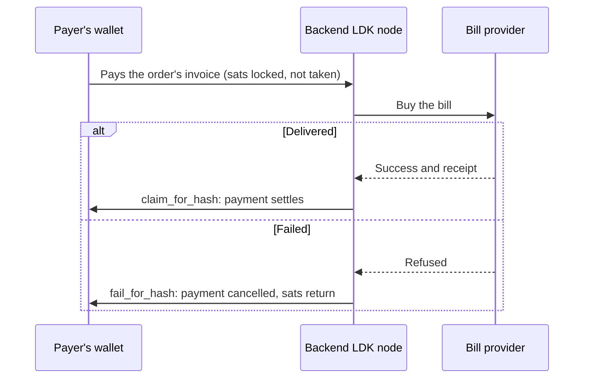

# ScorchePay

**Pay Nigerian bills with Bitcoin over Lightning, from your own wallet.** Airtime, data, electricity tokens and TV, priced in naira, without cashing out first. If a bill can't be delivered, the payment is cancelled and the sats go back to your wallet by themselves.

Built by ScorchedDevs for the Btrust × DevFest Kaduna hackathon.

## The problem

Nigeria is one of the world's biggest crypto markets (about $92B received in the year to June 2025, per Chainalysis), yet people who earn or hold Bitcoin can't spend it on everyday bills. That includes freelancers paid in crypto and families supported by relatives abroad. To buy airtime, data, an electricity token or a TV subscription, they sell on a P2P market, wait for naira in a bank account, then pay each bill separately, with fees and scam risk at every step. It happens every time a bill comes due.

Lightning apps cover little of it. Bitrefill sells MTN and Airtel airtime, but electricity only as one distributor's gift card.

## How it works

The backend runs its own Lightning node (LDK Node). It never holds a user's money: a payment is **held until the bill is delivered**.



1. The app asks for a quote: naira converted to sats at the live BTC/NGN price plus a 1.5% spread, valid for 2 minutes. The node returns a BOLT11 invoice created with `receive_for_hash`, so the server keeps the preimage.
2. The user's wallet pays it. The payment arrives as `PaymentClaimable` and is held.
3. A worker buys the bill. If it's delivered, `claim_for_hash` settles the payment and the user gets a receipt (for electricity, the token). If it fails, `fail_for_hash` cancels the payment and the sats return to the payer. There is no refund flow.

Late payments, payments to a replaced invoice, and bills started too close to the claim deadline are failed back too.

**Pay for me.** A user can ask anyone, for example family abroad, to pay a bill or an existing order. The payer opens a link, scans a QR code with any Lightning wallet, and pays: no account, no app.

## What's in this repo

| Path | What it is |
| --- | --- |
| [`backend/`](backend) | The Lightning backend: Rust, axum, Postgres, LDK Node 0.7. Accounts, KYC tiers, bills API, bill links, Swagger. Start with [`backend/README.md`](backend/README.md) |
| [`backend/docs/API_GUIDE.md`](backend/docs/API_GUIDE.md) | Every flow and endpoint, with examples |
| [`backend/docs/SYSTEM_DESIGN.md`](backend/docs/SYSTEM_DESIGN.md) | How the backend works, with diagrams |
| `lib/`, `ios/`, `android/`, … | The Flutter app: onboarding, the order flow, wallet connection over Nostr Wallet Connect |
| `docs/` | Notes on the app's bills flow, wallets and passkeys |
| `server/` | An older fiat prototype (Express). Not used |

## What was built when

The git history is kept as it happened.

- **The Flutter app** began on 30 August 2026. Its sign-up, VTU screens and wallet connection are in the earlier commits.
- **`backend/`**, with the hold-until-delivered Lightning payments, bill links, pricing, API docs and tests, was written for this hackathon in late October 2026. It was developed in a separate repository first and is added here as one commit.
- Two small app fixes were made along the way: the onboarding "Get Started" redirect and the iOS minimum version.

## Check it yourself

You need Rust, Postgres and `bitcoind` (`brew install bitcoin`).

```sh
cd backend
cargo test                  # 29 unit tests
scripts/e2e-regtest.sh      # end to end, real Lightning payments
```

The end-to-end script starts a private regtest `bitcoind` and the backend. A second LDK node opens a 1,000,000-sat channel to it and pays real invoices. Example output (the sats vary with the live price):

```
✓ 1,000,000 sat channel open: payer → ScorchePay
✓ ₦500 airtime delivered and 462 sats claimed
✓ failed bill handed the payment back
✓ payment to a replaced invoice refused; the order still awaits its new one
✓ bill link paid without an account (923 sats)
✓ existing order shared by link, requoted by its owner, paid by someone else (462 sats)
✓ payer spent exactly 1847 sats, for the three delivered bills
```

The last line shows the failed bill cost the payer nothing.

To try the API in a browser, run the backend (see [`backend/README.md`](backend/README.md)) and open `http://localhost:8080/docs`. The development-only simulate-payment endpoint lets you walk an order through every state without a Lightning wallet.

To run the app: `flutter run --dart-define=MOCK_WALLETS=true`.

## Status

**Works and is tested:** the hold-until-delivered payment flow with real Lightning payments on regtest, quoting and requoting, limits, bill links, accounts, profile photos, live pricing, and the API docs.

**Simulated or not done yet:**
- The app still runs on built-in mocks and isn't wired to the backend. [`backend/docs/API_GUIDE.md`](backend/docs/API_GUIDE.md) (section 16) maps each app call to its endpoint.
- Real purchases through SMEPlug and identity checks through Mono are written to their docs but untested against the real services. The demo uses fake providers.
- Electricity and TV use the fake provider until N3TData is added.
- The backend is configured for Mutinynet, but no funded channel exists there yet. The proof of real payments is the regtest run above.
- Sign-up codes are only logged, with no SMS or email delivery yet.
- Passkeys are not built in the backend.

## Next steps

Connect the app to the backend, add real electricity and TV, test the real providers, and move from Mutinynet to a funded mainnet node with monitoring and backups. Then add Hausa, Pidgin, Yoruba and Igbo, and an in-app LDK wallet so users no longer need a separate Lightning wallet.

## Team

ScorchedDevs: Blackscorche and Islam.

## Licence

MIT. See [`LICENSE`](LICENSE).
