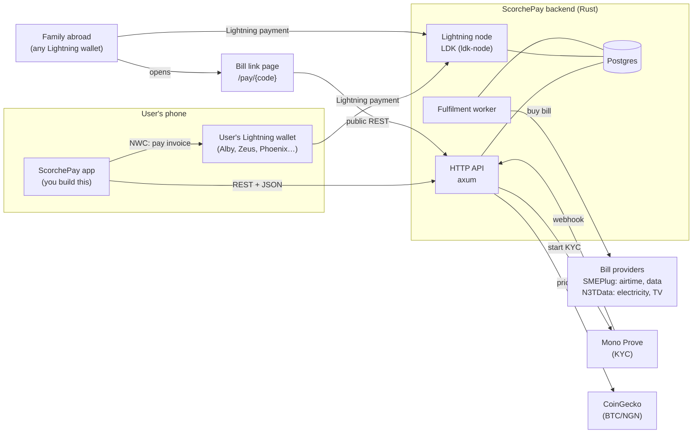
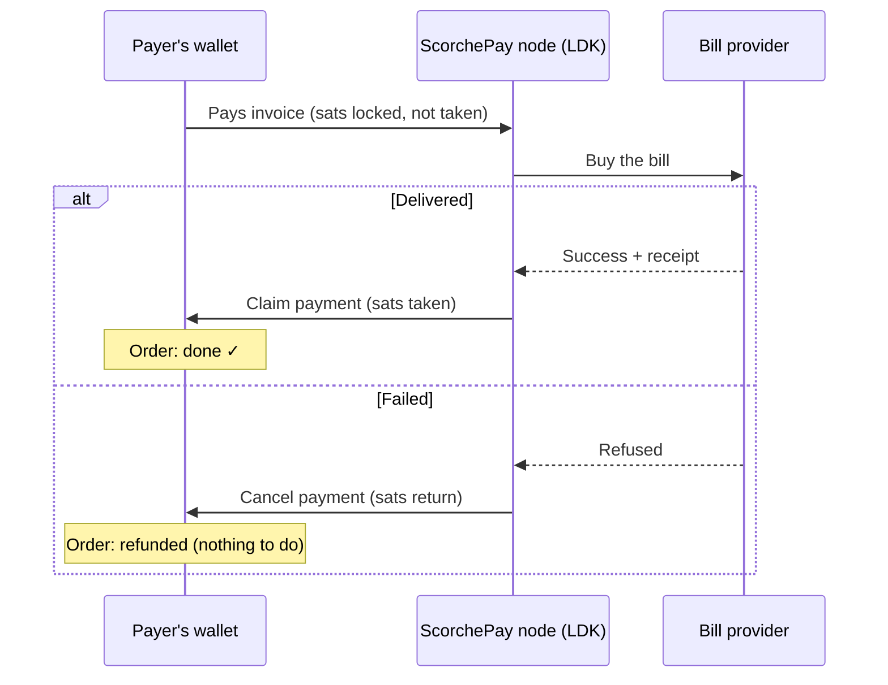
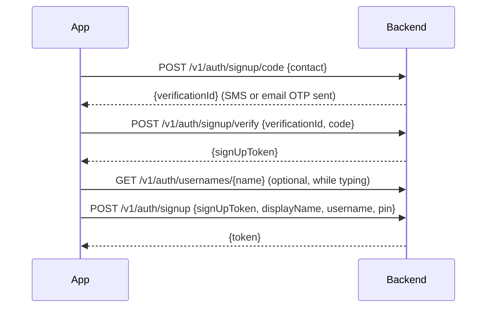
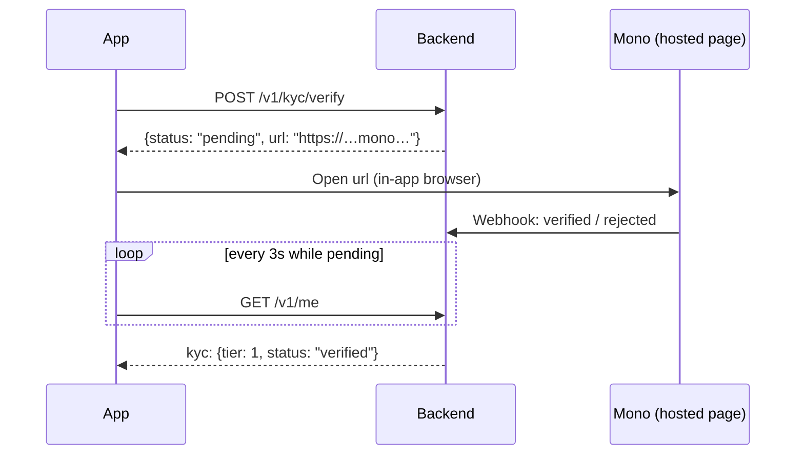
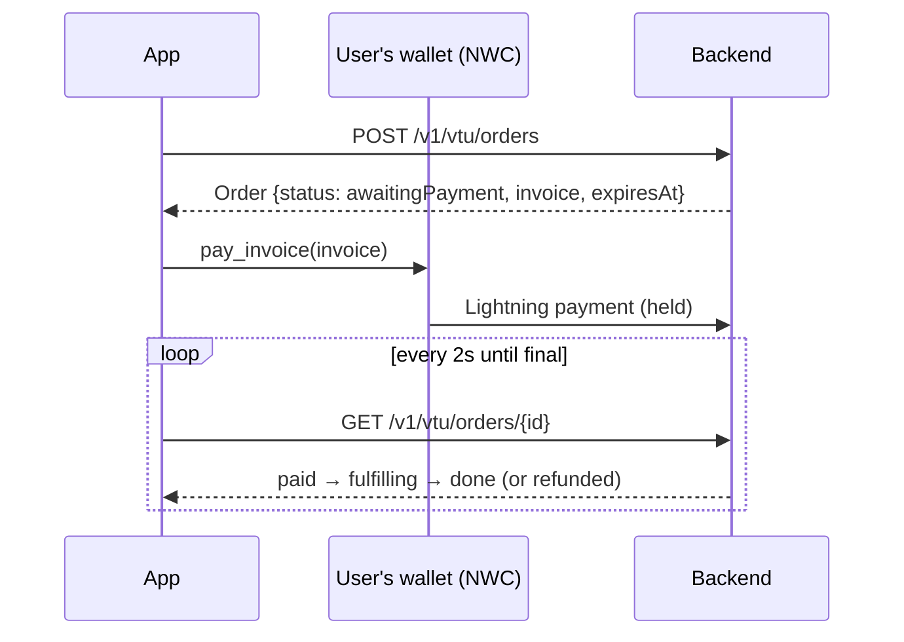
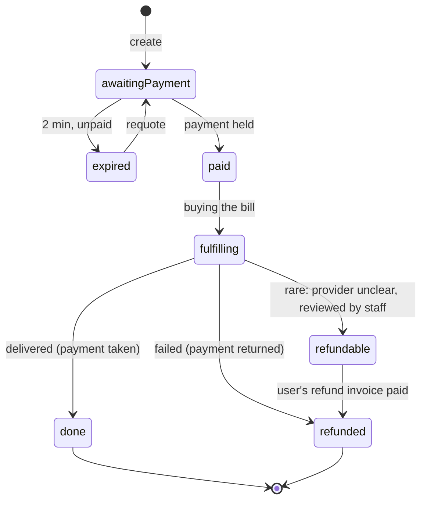
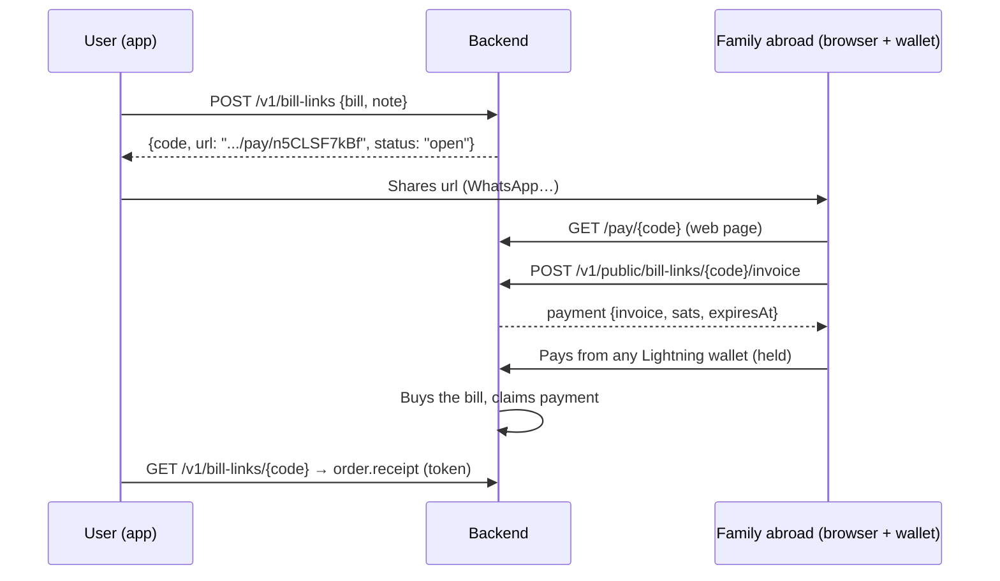

# ScorchePay backend: system design

**Who this is for:** the frontend developer building the ScorchePay app
and web pages against this backend. It covers how the backend works, the
flows you build screens for, every endpoint with real request and
response examples, and what to show for each state.

> **Looking for how to call each endpoint?** See
> [API_GUIDE.md](API_GUIDE.md): the flows step by step, then every
> endpoint with requests, responses, errors and UI notes.

**In one sentence:** ScorchePay lets people in Nigeria pay everyday bills
(airtime, data, electricity, TV) with Bitcoin over Lightning, from their
own wallet. The backend never holds anyone's money.

---

## 1. The big picture



| Piece | What it does |
| --- | --- |
| **HTTP API** | Accounts, KYC, the bill catalog, orders and bill links. JSON over HTTPS. |
| **Lightning node (LDK)** | Creates an invoice for each order, receives payments, and holds each payment until the bill is delivered. |
| **Fulfilment worker** | Buys each paid bill from the provider, then claims the held payment, or cancels it if the bill fails. |
| **Postgres** | Users, orders, bill links and KYC sessions. |
| **Providers** | SMEPlug for airtime and data. N3TData for electricity and TV (coming; a built-in fake stands in until then). |

**Your app never touches Lightning internals.** It gets a BOLT11 invoice
string from the backend and asks the user's wallet to pay it (through
Nostr Wallet Connect, as the current app does, or by opening the wallet
with a `lightning:` link or QR code).

---

## 2. The one rule that makes it safe

> **A payment is held until the bill is delivered.**
> If the bill fails, the payment is cancelled and the sats go straight
> back to the payer's wallet, automatically.



**What this means for the UI:**

- After paying, the wallet may show "pending" for a few seconds while the
  bill is bought. That's expected.
- A failed bill needs **no refund screen**. Show "Your sats went back to
  your wallet."
- Copy you can use: *"You only pay if your bill is delivered."*

---

## 3. Money, time and IDs

| Thing | Format | Example |
| --- | --- | --- |
| Naira amounts | Whole naira, integer | `5000` = ₦5,000 |
| Bitcoin amounts | Sats, integer | `3076` |
| Rate | Naira per BTC the user pays, spread included | `162548764.63` |
| Times | ISO 8601 UTC strings | `"2026-10-26T14:35:51.590052+00:00"` |
| Order IDs | 12 lowercase characters | `"f72gehss62uq"` |
| Bill link codes | 10 letters and digits, case-sensitive | `"n5CLSF7kBf"` |
| Invoices | BOLT11 strings | `"lntbs30760n1p4…"` (`lntbs` = signet test network) |

- **Quotes last 2 minutes** (`expiresAt`). Show a countdown.
- **Targets** (phone, meter or smartcard numbers) are sent without spaces
  or dashes. The backend strips them anyway.

---

## 4. Basics of the API

**Base URL**

| Environment | URL |
| --- | --- |
| Local | `http://localhost:8080` |
| Deployed | whatever `PUBLIC_URL` is set to |

**Authentication:** sign-up and login return a `token` (a JWT valid for 30
days). Send it on every user route:

```
Authorization: Bearer <token>
```

When it's missing or expired you get `401` with code `signedOut`: send
the user to login.

**Errors:** every error has the same shape. `message` is written for the
user, so you can show it as is. Branch on `code`.

```json
{ "error": { "code": "overLimit", "message": "This is over your ₦10,000 limit per order." } }
```

| `code` | HTTP | Meaning / what to do |
| --- | --- | --- |
| `signedOut` | 401 | Token missing or expired. Go to login |
| `auth` | 400 | Sign-up or login problem (wrong PIN, expired code…). Show the message |
| `usernameTaken` | 409 | Pick another username |
| `invalidTarget` | 422 | Phone, meter or smartcard number is malformed. Show it under the field |
| `customerNotFound` | 422 | No customer with that meter or smartcard. Show it under the field |
| `overLimit` | 422 | Over the user's KYC tier limit. Offer "Verify to raise your limit" |
| `alreadyPaid` | 409 | The order was paid meanwhile. Reload it |
| `billerUnavailable` | 503 | Provider down. Biller tiles can also come back `available: false` |
| `invalidInvoice` | 422 | Refund invoice is wrong (amount, network, expired) |
| `notFound` | 404 | Unknown order, link or biller |
| `network` | 503 | Price feed or KYC provider unreachable. Retry |
| `unknown` | 4xx | Anything else (e.g. "Choose a plan to continue."). Show the message |
| `cancelled`, `expired`, `inProgress` | 409 | Bill link states (section 9) |

---

## 5. Accounts

### Sign-up (3 steps, then the account is created)



| Endpoint | Body | Returns |
| --- | --- | --- |
| `POST /v1/auth/signup/code` | `{"contact": "ada@example.com"}` (phone or email) | `{"verificationId": "7b07…"}` |
| `POST /v1/auth/signup/verify` | `{"verificationId": "…", "code": "123456"}` | `{"signUpToken": "…"}` |
| `GET /v1/auth/usernames/{username}` | — | `{"available": true}` or `409 usernameTaken` |
| `POST /v1/auth/signup` | `{"signUpToken", "displayName", "username", "pin"}` | `{"token": "eyJ…"}` |
| `POST /v1/auth/login` | `{"username": "@ada", "pin": "1234"}` | `{"token": "eyJ…"}` |

**Rules:**

- **Usernames:** 3–20 characters of `a-z 0-9 _ .`. A leading `@` and
  capitals are fine; they're normalised.
- **PIN:** exactly 4 digits.
- **OTP:** 6 digits, valid for 10 minutes, 5 tries. Calling
  `signup/code` again resends (replaces the code).
- **Lockout:** 5 wrong PINs lock login for 15 minutes.
- **In development** the OTP is always `123456`.

### The current user

`GET /v1/me` (also `PATCH /v1/me` with `{"username"?, "displayName"?}`)

```json
{
  "id": "4cfb151d-d737-49e9-83a7-267d17efab05",
  "username": "ada_lovelace",
  "displayName": "Ada",
  "kyc": { "tier": 0, "status": "unverified" },
  "photoUrl": null
}
```

`kyc.status` is one of `unverified`, `pending`, `verified` or `rejected`.

---

## 6. KYC and limits

Limits are per order and per day, in naira, by KYC tier:

| Tier | Per order | Per day | How to get it |
| --- | --- | --- | --- |
| 0 | ₦10,000 | ₦30,000 | Every new account |
| 1 | ₦200,000 | ₦1,000,000 | Verify identity with Mono Prove |

"Today" runs from midnight Lagos time (WAT). Paid orders count, and so do
unexpired quotes. Expired and refunded orders don't count.

`GET /v1/vtu/limits`

```json
{
  "currency": "NGN", "tier": 0, "perOrder": 10000, "daily": 30000, "usedToday": 1000,
  "nextTier": { "currency": "NGN", "tier": 1, "perOrder": 200000, "daily": 1000000, "usedToday": 0, "nextTier": null }
}
```

Show `daily - usedToday` as "left today". Use `nextTier` for the
"Verify to raise your limit" prompt; it's `null` at the top tier.

### Verifying (raising the tier)



- `url` is `null` in development (the fake verifier approves within about 2 seconds). Just poll `/v1/me`.
- If the user is already tier 1, it returns `{"status": "verified", "url": null}`.

---

## 7. Buying a bill

### 7.1 The catalog builds the form

`GET /v1/vtu/catalog?country=NG` returns every biller. **Build the order
form from the biller, not from the category.** Each biller describes its
own fields:

```json
{
  "id": "gotv", "category": "tv", "name": "GOtv", "shortName": null, "brandColor": "#5BB947",
  "available": true, "customerCheck": true,
  "target": { "kind": "number", "label": "Smartcard (IUC) number", "hint": "10 or 11 digits",
              "pattern": "^\\d{10,11}$", "errorText": "Smartcard numbers are 10 or 11 digits." },
  "options": null,
  "pricing": { "type": "plans", "label": "Choose a package", "plans": [
    { "id": "gotv-smallie", "name": "Smallie", "amount": 1900, "validity": "1 month" },
    { "id": "gotv-jinja", "name": "Jinja", "amount": 3900, "validity": "1 month" } ] }
}
```

| Field | How to use it |
| --- | --- |
| `category` | `airtime`, `data`, `electricity` or `tv`. Groups the tiles |
| `name`, `shortName`, `brandColor` | Tile label (prefer `shortName`) and colour |
| `available` | `false` = show it greyed out, not tappable |
| `options` | If present, a choice before anything else (e.g. *Meter type: Prepaid / Postpaid*). Send the chosen `id` as `optionId` |
| `target` | The number field. `kind` picks the keyboard (`phone`, `number`, `text`). Validate with `pattern` and show `errorText` |
| `customerCheck` | If `true`, look up the customer (7.2) and show their name before the user can continue |
| `pricing.type = "amount"` | Free amount field, with `min`/`max` (either may be `null`) and `presets` chips. Send `amount` |
| `pricing.type = "plans"` | Plan picker. Send the plan's `id` as `planId` |

Cache the catalog for a few minutes; it rarely changes.

### 7.2 Customer check (meters and smartcards)

`POST /v1/vtu/customers/validate`

```json
{ "billerId": "ikedc", "target": "12345678901", "optionId": "prepaid" }
```

```json
{ "name": "EMEKA OKAFOR", "address": "22 Allen Avenue, Ikeja, Lagos" }
```

It returns `customerNotFound` when nobody has that number. Show "Paying
for EMEKA OKAFOR" and let the user confirm.

### 7.3 Create the order (locks a quote)

`POST /v1/vtu/orders` with an **OrderRequest**:

```json
{ "billerId": "mtn-data", "target": "08031234567", "planId": "mtn-2gb-30d" }
```

`billerId` and `target` are always required. Then send `optionId` if the
biller has options, `planId` for plan billers, or `amount` for
amount billers.

Response (an **Order**, the same shape everywhere):

```json
{
  "id": "zg6zhqmhu7yh",
  "title": "MTN 2GB",
  "status": "awaitingPayment",
  "category": "data",
  "billerId": "mtn-data",
  "billerName": "MTN",
  "target": "08031234567",
  "amount": 1500,
  "currency": "NGN",
  "sats": 923,
  "rate": 162513542.79,
  "invoice": "lntbs9230n1p4d7e8gdql2d3k7…",
  "createdAt": "2026-10-26T14:34:16.006533+00:00",
  "expiresAt": "2026-10-26T14:36:16.006210+00:00",
  "request": { "billerId": "mtn-data", "target": "08031234567", "optionId": null, "planId": "mtn-2gb-30d", "amount": null },
  "planName": "2GB",
  "optionName": null,
  "customerName": null,
  "paidAt": null,
  "receipt": null,
  "failureReason": null,
  "refundRequested": false
}
```

Show `title`, `amount` in naira, `sats`, and a countdown to `expiresAt`.
Then have the user's wallet pay `invoice`.

### 7.4 Pay, then follow the order



- **Poll** `GET /v1/vtu/orders/{id}` every 2 seconds while the status
  isn't final (see the state table). Stop when it is.
- **Quote expired** (status reads `expired`): offer "Get a new quote" with
  `POST /v1/vtu/orders/{id}/quote`. It's the same order ID with a new
  price, invoice and `expiresAt`, and the old invoice can't be paid any
  more. Send an OrderRequest body to change details (e.g. the user went
  back and changed the amount). Send no body to reprice as is.
  **Don't create a new order for a retry.**
- **History:** `GET /v1/vtu/orders?limit=20` lists orders newest first.
  Tapping one reopens the order screen, even if it's unpaid.

### 7.5 Order states: what to show



| `status` | Final? | Show | Main action |
| --- | --- | --- | --- |
| `awaitingPayment` | no | Quote: ₦ amount, sats, countdown, "Pay from" wallet | **Pay** |
| `expired` | yes* | "This quote expired" | **Get a new quote** (requote) |
| `paid` | no | "Payment received. Buying your bill…" (step 1 of 2) | none, keep polling |
| `fulfilling` | no | "Delivering…" (step 2 of 2) | none, keep polling |
| `done` | yes | Receipt (below) | Back to home |
| `refunded` | yes | `failureReason`, e.g. "MTN couldn't complete this bill. Your sats went straight back to your wallet." | Try again (new order) |
| `refundable` | yes | `failureReason`. Rare: only after a staff review | Paste refund invoice (7.6) |

\* Final until the user requotes it.

**Receipts** (`receipt` on `done` orders) are generic: render whatever
items arrive.

```json
{
  "reference": "FAKE-F72GEHSS62UQ",
  "message": "Enter the token on your meter to load the units.",
  "items": [
    { "label": "Token", "value": "1234-5678-9012-3456-7890", "primary": true, "copyable": true },
    { "label": "Units", "value": "22.2 kWh", "primary": false, "copyable": false }
  ]
}
```

Show `message`, then each item. `primary` items go large (the meter token
is what the user came for). `copyable` items get a copy button.
Airtime and data usually have just a `message`.

### 7.6 Refund (rare)

Only for `refundable` orders (staff confirmed the bill wasn't delivered
after the payment was taken). The user creates an invoice in their wallet
for **exactly** the order's `sats` and pastes it:

`POST /v1/vtu/orders/{id}/refund` `{"invoice": "lntbs…"}` returns the
Order with `refundRequested: true`. Keep polling until `refunded`. If the
payment fails, `refundRequested` goes back to `false` and the user can try
another invoice. With an NWC wallet that allows `make_invoice`, you can
create the invoice for the user automatically.

---

## 8. Bill links ("Pay my bill")

A user asks someone else (often family abroad) to pay one bill. The payer
needs **no account and no app**: just any Lightning wallet (Strike,
Phoenix, Wallet of Satoshi…). The same hold-until-delivered rule protects
the payer.



A link can wrap a **new bill** or an **order the user already created**
(`orderId`): then someone else pays that very order, and the link follows
it if the user requotes. See `API_GUIDE.md` section 5.

### For the requester (signed in)

| Endpoint | Purpose |
| --- | --- |
| `POST /v1/bill-links` | Body: `{orderId}` to share an existing unpaid order, or an OrderRequest for a new bill; plus optional `note` (≤ 140 chars). A new bill is checked now (target, plan, customer name, per-order limit). Returns the link. Links last 7 days |
| `GET /v1/bill-links` | The user's links, newest first |
| `GET /v1/bill-links/{code}` | One link, with its current `order` in full (receipt and token included) |
| `DELETE /v1/bill-links/{code}` | Cancel it. Refused (`alreadyPaid`) once paid or while a payment is held |

```json
{
  "code": "n5CLSF7kBf",
  "url": "http://localhost:8080/pay/n5CLSF7kBf",
  "status": "open",
  "title": "Ikeja Electric (Prepaid)",
  "category": "electricity",
  "billerName": "Ikeja Electric",
  "target": "12345678901",
  "amount": 5000,
  "currency": "NGN",
  "note": "Light for the house this week, thank you aunty",
  "request": { "billerId": "ikedc", "target": "12345678901", "optionId": "prepaid", "planId": null, "amount": 5000 },
  "createdAt": "2026-10-26T14:33:39.216274+00:00",
  "expiresAt": "2026-11-02T14:33:39.215833+00:00",
  "order": null
}
```

Share `url` with the platform share sheet. When `status` is `paid`, show
`order.receipt` (for electricity, that's where the token is).

### For the payer (public, no token)

The backend already serves a finished payer page at `GET /pay/{code}`
(mobile-friendly, with QR code, countdown and live status). You only
need these endpoints to build your own version, e.g. inside a website:

| Endpoint | Purpose |
| --- | --- |
| `GET /v1/public/bill-links/{code}` | What the payer sees (below) |
| `POST /v1/public/bill-links/{code}/invoice` | Get a payable invoice: the current one, a fresh quote if it expired, or a new attempt after a failed one |
| `GET /v1/public/bill-links/{code}/qr.svg` | The current invoice as a QR code (SVG) |

```json
{
  "code": "n5CLSF7kBf",
  "status": "paying",
  "requester": "Ada",
  "title": "Ikeja Electric (Prepaid)",
  "category": "electricity",
  "billerName": "Ikeja Electric",
  "target": "1234••••901",
  "amount": 5000,
  "currency": "NGN",
  "note": "Light for the house this week, thank you aunty",
  "expiresAt": "2026-11-02T14:33:39.215833+00:00",
  "payment": {
    "status": "awaitingPayment",
    "sats": 3076,
    "invoice": "lntbs30760n1p4d7ex0…",
    "expiresAt": "2026-10-26T14:35:51.590052+00:00",
    "paidAt": null,
    "message": null,
    "failureReason": null
  }
}
```

The payer never sees the full number or the receipt items (the token is
for the requester). `payment.status` uses the order states from 7.5.

| Link `status` | Meaning | Payer page shows |
| --- | --- | --- |
| `open` | Nothing paid yet, or the last attempt failed back | "Pay with Bitcoin" |
| `paying` | An invoice is out, or a payment is being delivered | QR + countdown, then "Buying the bill…" |
| `paid` | Delivered | "Bill paid ✓" |
| `cancelled` | The requester cancelled it | "Request cancelled" |
| `expired` | Older than 7 days | "Request expired" |

Errors from `.../invoice`: `alreadyPaid`, `inProgress`, `cancelled`,
`expired`, and `overLimit` (worded for the payer: the requester needs to
verify or wait until tomorrow).

---

## 9. Screens checklist

**App (signed out)**

- [ ] Sign-up: contact → OTP → name, username and PIN
- [ ] Login: username and PIN

**App (signed in)**

- [ ] Home: categories from the catalog, recent orders, limits left today
- [ ] Order form, built from the biller (options → target with customer check → plan or amount)
- [ ] Order screen: quote with countdown, Pay, polling, receipt, failed state, requote
- [ ] Order history
- [ ] KYC: "Verify to raise your limit" → Mono page → poll `/v1/me`
- [ ] Bill links: create (same form plus a note) → share → list → detail with receipt → cancel
- [ ] Wallet connection (NWC), as in the current app

**Web (optional):** the payer page already exists at `/pay/{code}`.
Restyle it or rebuild it from section 8.

---

## 10. Testing against the backend

**Run it locally:** follow `README.md` (`cargo run`). It serves
`http://localhost:8080`.

**Swagger:** open **`http://localhost:8080/docs`** to try every
endpoint in the browser.

1. Log in (`POST /v1/auth/login`) or sign up (OTP `123456`).
2. Copy the `token`, click **Authorize**, and paste it into
   **userToken**.
3. Create an order, then call
   **`POST /v1/dev/orders/{id}/simulate-payment`**: Swagger can't pay a
   Lightning invoice, so this marks it paid.
4. `GET` the order again to watch `paid` → `fulfilling` → `done`
   (about 1.5 s).

The simulate endpoint also works for bill link orders: the order ID is
in `GET /v1/bill-links/{code}` → `order.id`. It only exists when the
server runs with `DEV_SIMULATE_PAYMENTS=true`. Your app can call it from
a debug-only "Simulate payment" button too.

**Generate a client:** the OpenAPI spec at
`http://localhost:8080/openapi.yaml` has an `operationId` on every
endpoint, so tools like `openapi-generator` (Dart/Flutter, TypeScript)
can generate typed API code from it.

**Development behaviour** (fake providers, the default):

| Input | Result |
| --- | --- |
| Any sign-up OTP | `123456` works |
| Meter or smartcard ending `0000` | `customerNotFound` |
| Any target ending `9999` | The bill fails, so the payment goes back (`refunded`) |
| Anything else | Delivered after about 1.5 s; electricity gets a 20-digit token |
| KYC | Approved to tier 1 about 2 s after `POST /v1/kyc/verify` |

**Paying for real** needs a Lightning wallet on the same test network
(Mutinynet signet) and a node with a funded channel; see
`README.md`. The end-to-end test (`scripts/e2e-regtest.sh`)
proves the whole payment flow on a private local network.

---

## 11. Inside the backend (for reference)

| Area | File |
| --- | --- |
| Startup, wiring | `src/main.rs` |
| Settings (`.env`) | `src/config.rs`, `.env.example` |
| Accounts and sessions | `src/auth.rs` |
| KYC (Mono Prove) | `src/kyc.rs` |
| Catalog | `src/catalog.rs` |
| Orders, limits, payment holding, fulfilment | `src/orders.rs` |
| Bill links and payer page | `src/bill_links.rs`, `static/pay.html` |
| Lightning node | `src/lightning.rs` |
| Providers | `src/providers/` (`smeplug.rs`, `fake.rs`) |
| BTC/NGN rate | `src/rates.rs` |
| Admin (node funding, channels, reviews) | `src/admin.rs` |
| Database schema | `migrations/` |

**Guarantees the frontend can rely on:**

- **One purchase is one order.** Requotes keep the ID; old invoices stop
  working.
- **A late payment** (after expiry) or **one to a replaced invoice** is
  returned automatically, never kept.
- **A bill is only bought** with enough time left to claim the payment,
  so nobody is charged for a bill that wasn't attempted, and the business
  never delivers one it can't collect for.
- **If the provider gives no answer**, the order waits in `fulfilling`
  for a staff review instead of being bought twice.

## 11b. Spending rules, asking without an account, and the bill helper

Three small features sit around the order flow.

**Spending rules** (`policy.rs`). Each user can set a per-payment cap, a
daily cap and "trusted numbers only". `policy::check` runs right after a
bill is described and *before* its invoice is created, from every path that
can start a payment: a new order, a requote, a bill link and the helper. A
refusal is `422 policyBlocked` and is written to `policy_events`. The rules
only narrow what the KYC tier allows.

**Ask sessions** (`auth.rs`). `/v1/auth/ask/*` exchanges a phone code for a
token whose scope is `ask`. The `AuthUser` extractor accepts only `full`
sessions, and a separate `AskUser` extractor, used on just the customer
check, bill links and the helper, accepts both. So a verified phone number
can create links but can't reach orders, KYC or the rules. A number with no
account gets a guest user (`is_guest`, no usable PIN); signing up later with
the same contact claims it.

**Bill helper** (`helper.rs`). A pure parser turns a sentence into what was
understood (`Parsed`), then `resolve` matches that to the catalog. The
handler runs the result through `describe` and the user's rules and returns
a draft. It never creates an order.

## 12. Not built yet

- N3TData for real electricity and TV (the fake stands in).
- SMS and email delivery of OTPs (codes are only logged in development).
- Passkeys on the real backend (the app hides the option when the backend
  reports them as not configured).
- Mainnet (real Bitcoin). Everything currently runs on test networks.
